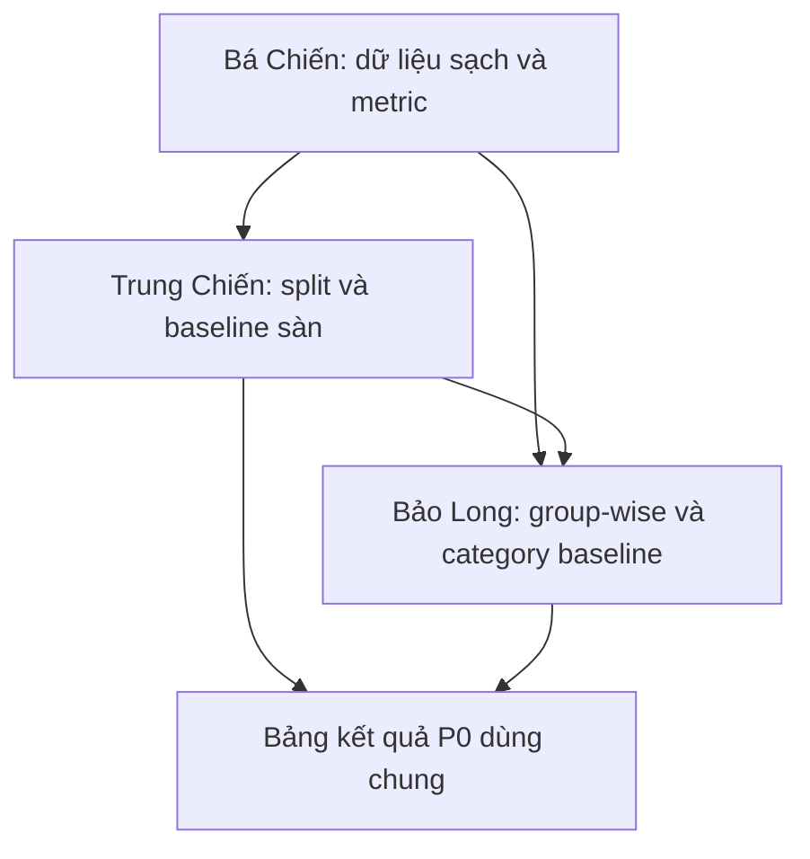
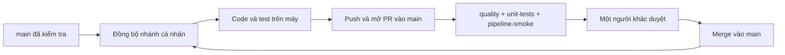

# main

# Recommender System - Phối hợp ba đề tài P0

[](https://github.com/baolong06/recommender_system/actions/workflows/ci.yml)

Repository chung của **Bá Chiến, Trung Chiến và Bảo Long** để đo lường khả năng xử lý
item cold-start của các baseline gợi ý theo phiên trên Yoochoose và Diginetica.
Mục tiêu là cùng dùng một bộ dữ liệu, metric, split và cách phân nhóm để kết quả so sánh được.

> **Trạng thái hiện tại:** đã có khung Python, metric và các hàm tham chiếu nhỏ,
> CI trên dữ liệu giả lập. Chưa có bộ xử lý Yoochoose/Diginetica đầy đủ,
> bộ chia dữ liệu thật hay Cat-Popularity. CI xanh chưa chứng minh kết quả nghiên cứu đúng
> trên toàn bộ dataset. Các phần đó được phân công bên dưới.

## 1. Phân công và tiêu chí bàn giao

| Người / nhánh | Nhiệm vụ chính | Nhận từ ai | Đầu ra để bàn giao |
| --- | --- | --- | --- |
| **Bá Chiến / `Ba-Chien`** | Dữ liệu sạch, thống kê và metric | Dữ liệu thô Yoochoose/Diginetica | Code làm sạch; manifest dữ liệu; bảng thống kê/biểu đồ; HR/MRR/NDCG có kiểm thử |
| **Trung Chiến / `Trung-Chien`** | Chia cold-start 20%, kiểm tra rò rỉ; Random/Popularity | Dữ liệu sạch và metric của Bá Chiến | Split dùng chung; cold item IDs; manifest/protocol; kết quả baseline sàn |
| **Bảo Long / `Long`** | Group-wise; Cat-Popularity oracle/non-oracle | Dữ liệu sạch, metric và split dùng chung | Code category baseline; báo cáo overall/warm/cold; kiểm thử phân nhóm; bảng so sánh |
| **Cả nhóm / `main`** | Ghép phần đã duyệt, giữ quy ước chung | Pull request của từng thành viên | Phiên bản chung CI đạt và dữ liệu/kết quả có thể truy nguyên |

### Bá Chiến - ĐT1

1. Viết bộ đọc dữ liệu thô, giữ ID thật và thống nhất kiểu timestamp/category.
2. Làm sạch theo phạm vi P0: xử lý phiên ngắn, item hiếm; ghi rõ thứ tự lọc,
   điều kiện dừng nếu dùng lọc lặp và số lượng trước/sau từng bước.
3. Thống kê số phiên, item, tương tác, độ dài phiên và phân phối long-tail.
4. Hoàn thiện bộ metric dùng chung; dùng ví dụ tính tay kiểm chứng.
5. Bàn giao script tái chạy, cấu hình, manifest và vị trí dữ liệu; không chỉ gửi notebook.

**Đạt khi:** người khác đọc được đầu ra theo schema đã chốt, kiểm thử lọc và metric đạt,
thống kê tái lập được; thay đổi metric phải được báo cho Trung Chiến và Bảo Long.

### Trung Chiến - ĐT2

1. Chốt cách chọn 20% cold item cùng cả nhóm; lưu seed, item universe và danh sách cold.
2. Tạo train/validation/test dùng chung; loại cold item khỏi dữ liệu dùng để fit.
3. Thêm kiểm tra rò rỉ theo protocol: session, thời gian và dữ liệu dùng để fit/tune.
4. Hoàn thiện Random/Popularity trên dữ liệu thật, chỉ học thống kê từ train.
5. Lưu split và manifest để mọi baseline dùng đúng cùng phiên bản, không tự chia lại.

**Đạt khi:** cold item vắng trong train, split tái tạo được, kiểm tra rò rỉ đạt,
manifest ghi được seed/checksum và Bảo Long chạy được trên đúng split đó.

### Bảo Long - ĐT3

1. Hoàn thiện bộ phân nhóm theo **item đích cần dự đoán**, không theo item trong lịch sử.
2. Chạy lại hai baseline sàn qua bộ group-wise để kiểm tra giao diện chung.
3. Viết Cat-Popularity oracle/non-oracle; mô tả chính xác mỗi chế độ được đọc thông tin gì.
4. Kiểm thử non-oracle không dùng đáp án thật/category của đáp án để tạo dự đoán.
5. Xuất overall/warm/cold, số mẫu từng nhóm, metric theo K, kết quả từng seed và bản tổng hợp.

**Đạt khi:** số mẫu warm + cold đúng tổng, oracle tách riêng, bảng so sánh dùng cùng split/metric,
kết quả có đủ thông tin tái lập. Không đặt điều kiện baseline category phải thắng baseline sàn.

## 2. Phụ thuộc công việc và thứ tự ưu tiên



Ưu tiên metric và giao diện dữ liệu trước, rồi split chuẩn. Trong lúc chờ dữ liệu thật,
Trung Chiến và Bảo Long dùng fixture để viết/kiểm tra phần độc lập.
Khi thay đổi metric, split hoặc cách phân nhóm, ghi trong PR phần nào phải chạy lại;
người sử dụng phần đó phải review trước khi ghép.

## 3. Cấu trúc dự án

```text
.github/
  workflows/ci.yml                  # Ba kiểm tra bắt buộc
  workflows/validate-results.yml    # Chạy fixture với ba seed, thủ công
  pull_request_template.md
configs/protocol.toml               # Phạm vi P0 và các quyết định còn phải chốt
src/recommender/
  contracts.py                     # Kiểm tra fixture đã chia sẵn
  metrics.py                       # HR/MRR/NDCG cho một next-item đúng
  baselines.py                     # Random/Popularity tham chiếu nhỏ
  evaluation.py                    # Tổng hợp overall/warm/cold
  smoke.py                         # Chạy thử fixture, xuất JSON
tests/
  fixtures/session_dataset.json    # Dữ liệu giả lập, được phép commit
  test_*.py
requirements-dev.txt
pyproject.toml
```

Khi bổ sung chức năng, có thể tách thành `data/`, `splits/`, `baselines/`, `evaluation/`
trong package `recommender`; cập nhật import và kiểm thử cùng PR.
Không tạo ba bản metric hoặc ba bản split riêng cho từng người.

## 4. Môi trường và lệnh kiểm tra trên máy

Dùng **Python 3.12** cho cả nhóm, giống CI. Các lệnh dưới chạy từ thư mục gốc repository.

### Windows PowerShell

```powershell
git clone https://github.com/baolong06/recommender_system.git
cd recommender_system
py -3.12 -m venv .venv
.\.venv\Scripts\python.exe -m pip install -r requirements-dev.txt -e .
.\.venv\Scripts\python.exe -m ruff check .
.\.venv\Scripts\python.exe -m ruff format --check .
.\.venv\Scripts\python.exe -m pytest
.\.venv\Scripts\python.exe -m recommender.smoke --output artifacts/smoke.json
```

Không cần kích hoạt môi trường hay đổi PowerShell execution policy nếu dùng đường dẫn Python như trên.

### Linux / macOS

```bash
python3.12 -m venv .venv
.venv/bin/python -m pip install -r requirements-dev.txt -e .
.venv/bin/python -m ruff check .
.venv/bin/python -m ruff format --check .
.venv/bin/python -m pytest
.venv/bin/python -m recommender.smoke --output artifacts/smoke.json
```

Các ví dụ `python -m ...` tiếp theo giả định đã kích hoạt `.venv`, hoặc thay `python`
bằng đường dẫn Python của môi trường như hai ví dụ trên.
Khi thêm pandas/numpy hay thư viện khác, khai báo dependency trong `pyproject.toml`,
cài lại môi trường và kiểm tra CI; không chỉ cài riêng trên máy rồi quên cập nhật cấu hình.

## 5. Giao diện dữ liệu và protocol

### Hợp đồng fixture đang được CI kiểm tra

- `catalog`: ánh xạ `item_id -> category_id`, cả hai là chuỗi ID.
- `train`: danh sách event có `session_id`, `item_id`, `timestamp`, `category_id`.
  Timestamp là số nguyên Unix seconds không âm, không giảm trong mỗi session.
- `validation` / `test`: các ví dụ `session_id`, `history` (danh sách item), `target`.
  Fixture dùng một ví dụ cho mỗi session; các session tách biệt giữa các split.
- `cold_items`: danh sách item không có trong train. Fixture có 5 item, chọn 1 item cold.
- Metric nhận danh sách item dự đoán theo thứ tự, một target và K. Không cho item lặp.
- Group-wise trả `n` và metric từng nhóm; nhóm rỗng có metric `null` (hiển thị N/A), không gán 0.

Fixture có dữ liệu **đã chia sẵn**, không đáp ứng điều kiện tần suất item của dataset thật.
Smoke kiểm tra từ bước nhận split đến metric/báo cáo, chưa kiểm tra tải, 5-core hay sinh split.
Trên dữ liệu thật, nếu tạo nhiều prefix từ cùng session, cần mở rộng schema/validator có
`example_id` và giữ kiểm tra chống session overlap giữa các split; không bỏ kiểm tra rò rỉ.

### Những điều cần thống nhất trước khi chạy dữ liệu thật

`configs/protocol.toml` đánh dấu protocol nghiên cứu là `pending-team-agreement`.
Phần `[smoke]` chỉ quy định bài chạy giả lập: top-3, toàn bộ catalog, tie-break theo item ID.
Đây chưa phải protocol thực nghiệm đã được giảng viên duyệt.

| Quyết định | Nội dung cần ghi rõ và duyệt chung |
| --- | --- |
| Cold item | 20% tính trên tập item nào; cách làm tròn; seed chọn item |
| Split | Theo session/thời gian, mốc chia và thứ tự làm sạch để tránh dùng thông tin tương lai |
| Candidate | Có cold item không; item nào khả dụng tại thời điểm gợi ý; xử lý item đã xem |
| Điểm bằng nhau | Quy tắc tie-break; không để thứ tự dữ liệu vô tình quyết định kết quả |
| Category | Nguồn metadata, thời điểm biết category; ranh giới oracle/non-oracle |
| Đánh giá | Giá trị K; cố định split hay lặp split seed; cách tổng hợp |

Mỗi baseline dùng cùng catalog/candidate policy tương ứng và cùng split.
Nếu candidate chỉ gồm item trong train, cold item không có cơ hội được gợi ý;
phải ghi rõ điều đó khi diễn giải số liệu. Không tự chọn một quy ước thuận lợi cho riêng mô hình.

## 6. Luồng branch và pull request



### 6.1. Đồng bộ lần đầu sau khi khung CI được thêm

Nhánh cá nhân hiện được tạo trước khung CI. **Workflow chỉ có trên nhánh nào đã nhận nó**;
trước khi làm việc, mỗi bạn nhập nền chung từ `main`. Ví dụ với Bảo Long:

```bash
git status
git fetch origin
git switch Long
git merge origin/main
```

Trung Chiến thay `Long` bằng `Trung-Chien`; Bá Chiến thay bằng `Ba-Chien`.
Chỉ đổi nhánh/merge khi đã commit hoặc cất công việc đang làm.

README cũ của nhánh cá nhân chỉ có tên nhánh nên lần đồng bộ đầu có thể xung đột README.
**Riêng xung đột đó**, giữ bản hướng dẫn chung từ `main`:

```bash
git restore --source=origin/main -- README.md
git add README.md
git status
```

Nếu có file khác xung đột, mở và xử lý riêng; không chọn ghi đè toàn bộ code.
Khi đã hết xung đột, hoàn tất merge bằng `git commit` nếu Git đang chờ, rồi `git push origin Long`.
Không đổi README về chỉ một dòng tên nhánh trong các PR sau.

### 6.2. Mỗi ngày / mỗi nhiệm vụ

1. `git fetch origin`, đổi sang nhánh của mình và `git merge origin/main` để nhận phần đã bàn giao.
2. Sửa code kèm kiểm thử; mỗi PR tập trung một việc có thể review.
3. Chạy Ruff và pytest trên máy như mục 4.
4. Commit có ý nghĩa và push đúng nhánh:

```bash
git add src/recommender tests
git commit -m "feat(metrics): add next-item evaluation"
git push origin Long
```

Lệnh `git add` là ví dụ cho thay đổi code/test; thêm đúng đường dẫn cấu hình/tài liệu nếu có.
Thay tên nhánh và nội dung commit theo việc thực tế.

5. Trên GitHub chọn **Pull requests -> New pull request**,
   đặt **base: main**, **compare: nhánh của mình**.
6. Điền mẫu PR, nêu input/output, lệnh đã chạy và ảnh hưởng tới tài sản dùng chung.
   Mở **Draft PR** sớm nếu đang làm để CI kiểm tra mỗi lần push.
7. Khi sẵn sàng, chuyển draft sang **Ready for review**, nhờ một bạn khác review.
8. CI đạt, nhánh đã cập nhật với main và có đủ review thì merge; giữ nhánh cá nhân để làm tiếp.

Nếu PR đang mở, chỉ cần push commit mới lên **cùng nhánh**, CI sẽ chạy lại.
Không mở PR mới cho từng lần sửa lỗi của cùng nhiệm vụ.

## 7. CI tự chạy lúc nào, kiểm tra gì?

Workflow **CI** chạy khi mở/cập nhật PR vào `main`, khi có push lên `main`, hoặc bấm Run workflow.
Push lên nhánh cá nhân **chưa có PR** không tự chạy CI; mở draft PR để có kiểm tra liên tục.

| Job bắt buộc | Lệnh chính | Hiện đang kiểm tra |
| --- | --- | --- |
| `quality` | `python -m ruff check .` và `python -m ruff format --check .` | Lỗi code cơ bản, import, định dạng |
| `unit-tests` | `python -m pytest -m 'not smoke'` | Metric tính tay, rò rỉ cold/session, schema, baseline và group-wise |
| `pipeline-smoke` | `python -m pytest -m smoke`; `python -m recommender.smoke` | Ghép split giả lập -> baseline -> metric -> báo cáo; tái lập ba seed |

Mỗi job dùng CPU, Python 3.12, giới hạn 10 phút. Lần chạy cũ của cùng PR bị hủy khi có bản cập nhật.
Actions dùng quyền đọc code, không cần token cá nhân hoặc dataset thật.
Mọi PR đều chạy bộ kiểm tra chung, kể cả khi sửa tài liệu; không dùng path filter làm treo required checks.
Các action được ghim bằng commit SHA, phiên bản tham khảo ghi ngay bên cạnh trong workflow.

**Cách xem:** vào PR -> Checks hoặc [Actions](https://github.com/baolong06/recommender_system/actions),
mở lần chạy -> mở job đỏ -> đọc bước lỗi đầu tiên.

| Lỗi | Cách xử lý |
| --- | --- |
| `quality` báo format | Chạy `python -m ruff format .`, xem diff rồi commit lại |
| `quality` báo import/biến chưa dùng | Chạy `python -m ruff check .`, sửa theo đường dẫn/dòng được báo |
| `unit-tests` đỏ | Chạy lại bài test tương ứng, sửa phép tính/hợp đồng dữ liệu; không xóa test để làm xanh |
| `pipeline-smoke` đỏ | Kiểm tra phần bàn giao giữa train/split, ranking, metric và group-wise |
| Nhánh chưa cập nhật | Nhập `origin/main` vào nhánh cá nhân, xử lý xung đột, push lại và chờ CI |
| Thiếu review | Nhờ một thành viên có quyền ghi repository duyệt; tác giả không tự duyệt PR của mình |

JUnit report được lưu 7 ngày; JSON smoke được lưu 7 ngày trong **Artifacts** của lần chạy.
CI xanh xác nhận các kiểm tra hiện có đạt; khi bổ sung code làm sạch/split/category thật,
phải bổ sung test tương ứng, không coi fixture hiện tại đã bao phủ chúng.

## 8. Workflow thủ công và kết quả nghiên cứu

Trong Actions chọn **Fixture reproducibility -> Run workflow -> main**.
Tên file là `validate-results.yml`, nhưng phiên bản hiện tại **chỉ chạy dữ liệu giả lập** với
ba seed 42, 43, 44. Nó lưu từng lượt, mean/sample standard deviation, checksum fixture/protocol,
commit và môi trường Python trong artifact `synthetic-fixture-three-seeds` trong 14 ngày.

Chạy tương tự trên máy:

```bash
python -m recommender.smoke --seeds 42 43 44 --output artifacts/fixture-three-seeds.json
```

Không dùng các số trong JSON này cho bài báo. Chưa có workflow chạy thực nghiệm đầy đủ;
khi các phần dữ liệu thật và baseline đã sẵn sàng, nhóm bổ sung runner tương ứng vào một PR riêng.

Kết quả P0 chính thức cần:

- Cùng data version, protocol và split tương ứng cho tất cả baseline.
- Tối thiểu ba seed khác nhau theo tài liệu P0; ghi rõ seed mô hình và seed chia dữ liệu.
  Nếu thay split seed, mỗi baseline phải dùng cùng bộ split cho seed đó.
- HR/MRR/NDCG theo K; overall/warm/cold và số mẫu từng nhóm; mỗi seed và mean ± sample std (`ddof=1`).
- Dataset/split checksum, config, commit, phiên bản môi trường và lệnh tái chạy.
- Bản lưu lâu dài do nhóm thống nhất; Actions artifact ngắn hạn không phải kho lưu kết quả cuối.

Metric `0` là đã đánh giá và không trúng; `N/A` là không hỗ trợ/không xác định kèm lý do.
Không điền 0 để che trường hợp không hỗ trợ, không biến nhóm rỗng thành điểm 0.
Không bắt CI đòi HR vượt một ngưỡng hoặc đòi một mô hình luôn thắng mô hình khác.

## 9. Dữ liệu và ranh giới P0

- Chỉ commit code, cấu hình, fixture nhỏ và tài liệu. Dataset lớn để ở nơi lưu chung phù hợp điều kiện sử dụng;
  `data/raw/`, `data/processed/`, `data/splits/` và `artifacts/` đã được ignore.
- Commit manifest nhỏ/checksum và hướng dẫn lấy đúng dữ liệu; không cần commit dữ liệu thật để CI nhanh chạy.
- Không commit token, file `.env` hoặc đường dẫn tuyệt đối chỉ chạy được trên máy một người.
- Giữ phạm vi cold item **20%**, không tự quét nhiều tỷ lệ trong P0.
- Không thêm cách bù vector category cho cold item ngoài phạm vi đề tài.
- Mô tả hiện tượng đo được; số xấu/bất ngờ vẫn báo trung thực, không chỉnh cho đẹp.
- Cả ba phần P0 hiện tại không yêu cầu GPU; phần mô hình nơ-ron là hướng dự phòng riêng.

## 10. Quy tắc bảo vệ main

Main dùng quy trình PR, một review và ba check `quality`, `unit-tests`, `pipeline-smoke`.
Nhánh PR phải cập nhật với main trước khi ghép; cấm force-push và xóa main.
Không đổi tên job bắt buộc nếu chưa cập nhật thiết lập bảo vệ nhánh tương ứng.

Quản trị viên quản lý tại **Settings -> Branches -> Branch protection rules**.
Cả ba người cần quyền ghi repository để push nhánh và review; tên nhánh không tự cấp quyền tài khoản.
Nếu chưa có tài khoản của hai bạn trong repo, chủ repo thêm tại **Settings -> Collaborators**.

## 11. Checklist bắt đầu cho nhóm

- [ ] Cài Python 3.12, clone và chạy bộ kiểm tra mục 4.
- [ ] Đồng bộ main vào nhánh cá nhân theo mục 6.1.
- [ ] Cả nhóm chốt các quyết định protocol mục 5 trước khi chạy dataset thật.
- [ ] Bá Chiến ưu tiên metric và schema dữ liệu sạch.
- [ ] Trung Chiến ưu tiên split/manifest và bài test chống rò rỉ.
- [ ] Bảo Long ưu tiên group-wise và giao diện category baseline trên dữ liệu mẫu.
- [ ] Mở draft PR sớm; bàn giao qua PR và main, không chép file riêng giữa các nhánh.

## Tài liệu tham khảo

- Tài liệu nhóm: *Phối hợp 3 đề tài - Bá Chiến, Trung Chiến, Bảo Long - P0*.
- [GitHub Actions cho Python](https://docs.github.com/en/actions/tutorials/build-and-test-code/python)
- [Sự kiện kích hoạt workflow](https://docs.github.com/en/actions/reference/workflows-and-actions/events-that-trigger-workflows)
- [Bảo vệ nhánh](https://docs.github.com/en/repositories/configuring-branches-and-merges-in-your-repository/managing-protected-branches/about-protected-branches)
