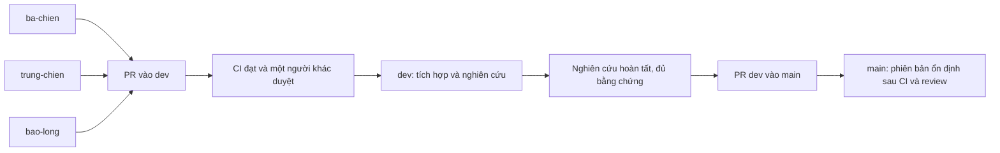

# Recommender System - Hướng dẫn nhiệm vụ, setup và phối hợp

Repository nghiên cứu P0 của **Bá Chiến, Trung Chiến và Bảo Long**: đo lường các baseline
gợi ý theo phiên khi gặp sản phẩm cold-start trên **Yoochoose và Diginetica**.
Ba người dùng chung dữ liệu, metric, split và cách phân nhóm để kết quả so sánh được.

README này được dùng chung trên các nhánh. Chọn đúng mục nhiệm vụ theo nhánh đang làm;
không đổi README thành một dòng tên cá nhân khi merge.

## 1. Chọn đúng nhánh và nhiệm vụ

| Nhánh | Người / mục đích | Làm gì trên nhánh? | PR vào đâu? |
| --- | --- | --- | --- |
| `ba-chien` | Bá Chiến - ĐT1 | Dữ liệu sạch, thống kê, HR/MRR/NDCG | `dev` |
| `trung-chien` | Trung Chiến - ĐT2 | Split cold-start 20%, chống rò rỉ, Random/Popularity | `dev` |
| `bao-long` | Bảo Long - ĐT3 | Group-wise và Cat-Popularity oracle/non-oracle; tích hợp gia cố CI | `dev` |
| `dev` | Bản tích hợp của nhóm | Ghép các phần đã review, kiểm tra giao diện và tiếp tục nghiên cứu | `main` khi nghiên cứu hoàn tất |
| `main` | Bản ổn định đã chốt | Tái chạy, kiểm chứng và lưu phiên bản dùng để báo cáo | Chỉ nhận từ `dev` |



**Công việc nghiên cứu luôn đi qua `dev` trước.** Không push code thẳng vào `dev/main`,
không gửi nhánh cá nhân thẳng vào `main`, không tự duyệt PR của mình.
Thay đổi tài liệu trên nhánh bảo vệ cũng cần review hoặc ngoại lệ do chủ repo xác nhận riêng;
việc sửa README không có nghĩa nghiên cứu đã được duyệt.

## 2. Nhiệm vụ nhánh ba-chien - Bá Chiến

**Mục tiêu:** tạo nền dữ liệu và thước đo chung cho hai bạn còn lại.

**Đầu vào:** dữ liệu thô Yoochoose/Diginetica và quy ước schema cả nhóm thống nhất.
Giữ mã item/category thật; tên sản phẩm và số liệu minh họa trong tài liệu không phải nhãn/kết quả thật.

| Việc cần làm | Yêu cầu | Đầu ra bàn giao |
| --- | --- | --- |
| Đọc dữ liệu | Nhận session, item, timestamp, category; kiểm tra kiểu và ID | Code đọc dữ liệu, mô tả schema |
| Làm sạch | Xử lý phiên ngắn dưới 2 item, item dưới 5 lần theo protocol; ghi rõ thứ tự lọc/lọc lặp | Script và cấu hình tái chạy, số lượng trước/sau |
| Thống kê | Số phiên/item/tương tác; độ dài phiên; phân phối tần suất/long-tail | Bảng thống kê, biểu đồ và lệnh tạo |
| Metric | HR@K, MRR@K, NDCG@K dùng chung; quy ước K và đầu vào rõ | Hàm metric có test tính tay |
| Bàn giao | Có phiên bản và checksum, không chỉ gửi notebook hoặc ảnh kết quả | Manifest dữ liệu và hướng dẫn lấy đúng bản |

**Tiêu chí hoàn tất:**

- [ ] Bộ đọc/lọc chạy lại được; schema thống nhất và thống kê có bằng chứng.
- [ ] Test lọc phiên/item và metric đạt; xử lý danh sách rỗng, K, item dự đoán trùng rõ ràng.
- [ ] Trung Chiến và Bảo Long đọc được dữ liệu và gọi cùng bộ metric.
- [ ] PR nêu ảnh hưởng nếu sửa cách metric, tie-break hoặc làm sạch; người dùng lại phần đó review.

Ưu tiên metric và schema trước để hai bạn kia làm song song. Không tự viết baseline category
hoặc thay split của Trung Chiến nếu chưa thống nhất.

## 3. Nhiệm vụ nhánh trung-chien - Trung Chiến

**Mục tiêu:** tạo luật chia dữ liệu công bằng và hai baseline mốc sàn.

**Đầu vào:** dữ liệu sạch, manifest và metric từ Bá Chiến. Khi chưa có dữ liệu thật,
dùng fixture nhỏ để phát triển phần độc lập; không dùng kết quả fixture làm số liệu P0.

| Việc cần làm | Yêu cầu | Đầu ra bàn giao |
| --- | --- | --- |
| Chọn cold item | Giữ 20%; chốt item universe, cách làm tròn và seed | Cold item IDs, cấu hình và giải thích |
| Tạo split | Train/validation/test theo quy ước session/thời gian đã duyệt | Split files và script tái tạo |
| Chống rò rỉ | Cold item không nằm trong dữ liệu fit; kiểm tra session, thời gian và dữ liệu tune | Test và báo cáo kiểm tra |
| Random | Seed tái lập được; đúng cùng tập candidate đã thống nhất | Code, cấu hình và kết quả từng seed |
| Popularity | Chỉ học thống kê từ train; tie-break rõ ràng | Code và kết quả trên cùng split |
| Bàn giao | Tất cả baseline dùng cùng phiên bản split; không để mỗi người chia lại | Manifest dữ liệu/split, checksum, seed và lệnh chạy |

**Tiêu chí hoàn tất:**

- [ ] Không có cold item trong train; không có rò rỉ theo protocol đã chốt.
- [ ] Cùng dữ liệu, cấu hình và seed tái tạo cùng split.
- [ ] Hai baseline dùng metric của Bá Chiến, không tạo bản metric riêng.
- [ ] Bảo Long chạy được trên đúng split/candidate policy đã bàn giao.
- [ ] Có kết quả từng seed và trung bình ± độ lệch chuẩn khi chạy nghiên cứu thật.

Không học độ phổ biến từ validation/test; không tự quét 10%, 30% hoặc các tỷ lệ cold khác trong P0.

## 4. Nhiệm vụ nhánh bao-long - Bảo Long

**Mục tiêu:** đo riêng warm/cold và xác định hiện tượng khi dùng thông tin category.

**Đầu vào:** dữ liệu sạch + metric của Bá Chiến; split, cold IDs và baseline sàn của Trung Chiến.

| Việc cần làm | Yêu cầu | Đầu ra bàn giao |
| --- | --- | --- |
| Group-wise | Phân nhóm theo item đích cần dự đoán, không theo item lịch sử | Công cụ overall/warm/cold và test |
| Ghép baseline sàn | Đo lại Random/Popularity bằng cùng công cụ | Bảng đối chiếu giao diện/kết quả |
| Cat-Popularity | Tách oracle và non-oracle; ghi rõ thông tin được phép đọc | Code, cấu hình và test chống dùng đáp án |
| Báo cáo | HR/MRR/NDCG theo K, số mẫu từng nhóm, kết quả từng seed | Bảng kết quả có thể truy nguyên |
| CI và phối hợp | Thay đổi luật/metric/protocol cần người khác review | PR vào dev, tài liệu và bằng chứng kiểm tra |

**Tiêu chí hoàn tất:**

- [ ] `n_warm + n_cold = n_overall`; nhóm rỗng là N/A, không biến thành điểm 0.
- [ ] Non-oracle không dùng đáp án thật/category của đáp án để tạo dự đoán.
- [ ] Oracle được đánh dấu riêng; mọi baseline dùng cùng split và thước đo.
- [ ] Có ba seed và mean ± sample std; có report, config, checksum, commit và lệnh tái chạy.
- [ ] Kết luận mô tả số liệu; không sửa quy trình để làm mô hình của mình thắng.

Không tự thêm kỹ thuật bù vector trung bình category ngoài phạm vi P0.
Nếu mô hình không hỗ trợ trường hợp cold, ghi N/A và lý do; không tự điền kết quả giả.

## 5. Nhiệm vụ nhánh dev - tích hợp nghiên cứu

`dev` là nơi ba phần gặp nhau, chưa phải tuyên bố nghiên cứu đã hoàn tất.

1. Nhận PR từ `ba-chien`, `trung-chien`, `bao-long`; mỗi PR tập trung một việc.
2. Reviewer kiểm tra input/output, test, ảnh hưởng tới phần dùng chung và nguồn dữ liệu.
3. Ghép khi CI đạt, nhánh nguồn cập nhật với dev và có một người khác duyệt.
4. Chạy tích hợp trên fixture trước; sau đó chạy dataset thật theo protocol đã chốt.
5. Theo dõi các quyết định còn mở, kết quả ba seed và hồ sơ bàn giao.
6. Chỉ mở PR `dev -> main` để chốt nghiên cứu khi đáp ứng mục 6.

**Yêu cầu:** không sửa trực tiếp để né review, không sửa/xóa test chỉ để CI xanh,
không đưa code chưa bàn giao làm baseline tham chiếu cho cả nhóm.

## 6. Nhiệm vụ nhánh main - chốt bản ổn định

`main` dùng để tái chạy và công bố đúng phiên bản đã kiểm chứng, không làm nơi thử nghiệm hằng ngày.

Chỉ nhận PR từ `dev` khi:

- [ ] Dữ liệu/split, metric và baseline đã hoàn tất, kiểm tra rò rỉ đạt.
- [ ] Có kết quả thật tối thiểu ba seed, tách overall/warm/cold và ghi số mẫu.
- [ ] Protocol được cả nhóm chốt; `research.status = "approved"`, giải quyết hết câu hỏi mở.
- [ ] `docs/research-readiness.json` có trạng thái `complete`, summary và năm mục xác nhận.
- [ ] Có bốn file bằng chứng không rỗng: data manifest, split manifest, results manifest, report.
- [ ] Người khác kiểm tra chất lượng bằng chứng, CI đạt và PR cập nhật với main.

Không đánh dấu hoàn tất chỉ vì chạy fixture thành công. CI kiểm tra khai báo và sự hiện diện
của hồ sơ; chất lượng khoa học vẫn cần người review xác nhận.
Không ghép một PR nghiên cứu đang thiếu bằng chứng chỉ để làm README trên main mới hơn.

## 7. Trạng thái nền code và các điều kiện đang áp dụng

Tại lần cập nhật tài liệu 10/11/2026:

- `main`: có khung Python/fixture đầu tiên, chưa nhận toàn bộ luật dev và gia cố.
- `dev`: có metric, validator, baseline tham chiếu, group-wise và luật nhánh; chưa có runner dataset thật.
- `bao-long`: có bản gia cố đang chờ [PR #1](https://github.com/baolong06/recommender_system/pull/1) vào dev.
- `ba-chien`, `trung-chien`: trước khi nhận nền dev chỉ có README; làm bước đồng bộ bên dưới trước setup.
- Cả ba đề tài chưa cần GPU. Chưa có xử lý Yoochoose/Diginetica đầy đủ, split thật hoặc Cat-Popularity hoàn chỉnh.

Các trạng thái này phải được cập nhật khi code được bàn giao. README là hướng dẫn công việc,
không phải bằng chứng các nhiệm vụ đã làm xong.

## 8. Setup lần đầu trên Windows PowerShell

**Cần có:** Git, Python 3.12, quyền đọc repository; quyền ghi để push/review.
Node.js 24 hoặc mới hơn cần khi chạy bộ test workflow của bản gia cố.
Không cần GPU, token cá nhân trong file cấu hình hoặc dataset thật để chạy fixture.

### 8.1. Clone và chọn nhánh

```powershell
git clone https://github.com/baolong06/recommender_system.git
cd recommender_system
git fetch origin
git switch ba-chien
```

Đổi lệnh cuối thành `git switch trung-chien`, `git switch bao-long`, `git switch dev`
hoặc `git switch main` theo đúng vai trò. Nếu máy đã có repository, không clone đè;
chạy `git status`, commit/cất công việc rồi fetch và đổi nhánh.

### 8.2. Nhận nền chung trên nhánh cá nhân

Chỉ làm bước này trên `ba-chien`, `trung-chien` hoặc `bao-long`:

```powershell
git status
git fetch origin
git merge origin/dev
```

Nếu README xung đột, giữ bản hướng dẫn chung đã được nhóm cập nhật; xem từng file khác
và không chọn ghi đè toàn bộ code. Sau khi sửa xong: `git add README.md`, xử lý hết file
xung đột còn lại rồi `git commit` nếu Git đang chờ hoàn tất merge.

Trên `dev/main`, chỉ lấy bản đã ghép bằng `git pull --ff-only origin dev` hoặc
`git pull --ff-only origin main` khi đang đứng đúng nhánh tương ứng; không tự merge nhánh cá nhân ở đây.

Tên nhánh cũ đã đổi: `Long -> bao-long`, `Ba-Chien -> ba-chien`, `Trung-Chien -> trung-chien`.
Nếu local còn tên cũ, dùng `git branch -m TEN_CU ten-moi`, fetch rồi đặt upstream bằng
`git branch --set-upstream-to=origin/ten-moi ten-moi`. Với đổi hoa/thường trên Windows,
đổi qua một tên tạm nếu cần; không push tạo lại tên cũ.

### 8.3. Tạo môi trường và cài dependencies

Chạy từ thư mục gốc, sau khi đã có `pyproject.toml`:

```powershell
if (-not (Test-Path pyproject.toml)) {
    throw "Nhanh chua co nen Python. Hay dong bo dev tren nhanh ca nhan truoc."
}
py -3.12 -m venv .venv
if (Test-Path requirements-dev.in) {
    .\.venv\Scripts\python.exe -m pip install --require-hashes --only-binary=:all: -r requirements-dev.txt
    .\.venv\Scripts\python.exe -m pip install --no-build-isolation --no-deps -e .
} else {
    .\.venv\Scripts\python.exe -m pip install -r requirements-dev.txt -e .
}
```

Điều kiện trên hỗ trợ cả nền cũ và bản gia cố có lock hash. Không tự thêm `--require-hashes`
vào file cũ chưa có hash. Khi bản gia cố đã vào dev, đồng bộ dev để dùng cách cài mới.
Không cần đổi execution policy hoặc kích hoạt môi trường vì các lệnh dùng đường dẫn Python cụ thể.

Linux/macOS dùng `python3.12 -m venv .venv`, thay `.\.venv\Scripts\python.exe`
bằng `.venv/bin/python` trong các lệnh cài và kiểm tra tương ứng.

### 8.4. Chạy kiểm tra và fixture

```powershell
.\.venv\Scripts\python.exe -m ruff check .
.\.venv\Scripts\python.exe -m ruff format --check .
.\.venv\Scripts\python.exe -m pytest
.\.venv\Scripts\python.exe -m recommender.smoke --output artifacts/smoke.json
.\.venv\Scripts\python.exe -m recommender.smoke --seeds 42 43 44 --output artifacts/fixture-three-seeds.json
if (Test-Path .github/tests/trusted-policy.test.cjs) {
    node --test .github/tests/trusted-policy.test.cjs
}
```

JSON fixture chỉ dùng kiểm tra phần ghép nối và khả năng tái lập, không dùng làm kết quả bài P0.
Artifact đầu ra không cần commit. `python -m ...` ở phần khác có thể thay bằng Python của `.venv`.

## 9. Cấu trúc và hợp đồng dữ liệu dùng chung

Sau khi nhận nền code:

```text
.github/workflows/       CI và workflow fixture
configs/protocol.toml    Các quy ước P0 và quyết định còn mở
docs/                   Kế hoạch, hồ sơ nghiên cứu và hướng dẫn
src/recommender/         Metric, validator, baseline, group-wise và runner fixture
tests/fixtures/          Dữ liệu giả lập nhỏ được phép commit
tests/                  Test tương ứng từng phần
pyproject.toml           Package Python và cấu hình công cụ
requirements-dev.txt    Dependencies để chạy kiểm tra
```

Bản gia cố còn có input/lock audit, CODEOWNERS, workflow luật tin cậy và hướng dẫn bảo mật.
Khi tách thêm `data/`, `splits/`, `baselines/`, cập nhật import và test trong cùng PR.

| Thành phần fixture | Hợp đồng |
| --- | --- |
| Catalog | Ánh xạ chuỗi item ID sang chuỗi category ID |
| Train | Event có session_id, item_id, timestamp Unix seconds và category_id; thời gian không giảm trong session |
| Validation/test | Ví dụ có session_id, history và target; fixture dùng một ví dụ cho một session |
| Cold IDs | Không xuất hiện trong train; fixture có 1/5 item cold |
| Ranking | Danh sách item có thứ tự, không trùng; một target đúng và K dương |
| Group-wise | Theo target; ghi n và metric của overall/warm/cold; nhóm rỗng là null/N/A |

Ví dụ tính tay cho target ở hạng 3, K >= 3: HR = 1, MRR = 1/3, NDCG = 0.5.
Nếu dùng nhiều prefix trong một session thật, mở rộng schema có example_id;
vẫn phải giữ kiểm tra chống session overlap giữa các split.
Fixture đã chia sẵn, chưa kiểm tra tải dữ liệu, lọc 5-core hoặc thuật toán tạo split thật.

## 10. Các quy ước phải chốt trước khi chạy dataset thật

1. Cold item: 20% tính trên tập nào, cách làm tròn, seed chọn item.
2. Split: session hay thời gian, mốc chia, thứ tự làm sạch và xử lý phiên sau khi loại cold item.
3. Candidate: item nào được phép gợi ý, có cold item không, thời điểm khả dụng, item đã xem.
4. Tie-break: xử lý điểm bằng nhau nhất quán giữa các mô hình.
5. Category: nguồn metadata và thông tin được dùng trong oracle/non-oracle.
6. Đánh giá: K, cố định split hay lặp split seed, cách tổng hợp.

Ghi các quyết định trong protocol/tài liệu chung và review. Không coi quy ước fixture top-3,
toàn catalog và tie-break theo item ID là protocol nghiên cứu đã duyệt.
Nếu candidate chỉ gồm item train, cold item không có cơ hội được gợi ý; phải ghi rõ khi diễn giải.

## 11. Công việc hằng ngày và PR

1. Trên nhánh cá nhân: `git fetch origin`, `git merge origin/dev` sau khi đã lưu công việc.
2. Code kèm test; thay đổi metric/split/group-wise phải thông báo trong PR để người dùng lại review.
3. Chạy kiểm tra mục 8.4; xem diff rồi chỉ stage những file của nhiệm vụ.
4. Ví dụ trên nhánh Bá Chiến:

```powershell
git add README.md src/recommender tests
git commit -m "feat(data): add validated preprocessing"
git push origin ba-chien
```

Lệnh stage là ví dụ sau khi có nền code; chọn đúng file thực tế, không stage dữ liệu lớn.
Trung Chiến/Bảo Long dùng đúng nhánh và nội dung commit của mình.

5. Trên GitHub: **Pull requests -> New pull request**, base = `dev`, compare = nhánh cá nhân.
6. Điền nhiệm vụ, input/output, lệnh kiểm tra, thay đổi protocol và bằng chứng bàn giao.
7. Mở Draft PR sớm để CI chạy sau mỗi lần push; sẵn sàng thì Ready for review.
8. CI đạt và có người khác duyệt mới ghép. Giữ nhánh cá nhân để làm tiếp.

Nếu PR đang mở, push commit mới lên cùng nhánh; không tạo PR mới cho mỗi lần sửa lỗi.
Nếu README khác nhau do bản hướng dẫn cũ, reviewer giữ hướng dẫn chung mới nhất,
không xóa phần nhiệm vụ người khác. Bàn giao qua dev, không chép một bộ metric/split riêng.

## 12. CI và cách xử lý lỗi

CI chạy trên PR vào dev/main và push lên dev/main; nhánh cá nhân chưa có PR không tự chạy.
Bản gia cố còn kiểm tra đề xuất Dependabot vào bao-long để cập nhật đi qua nhánh cá nhân trước.

| Check | Ý nghĩa | Khi lỗi |
| --- | --- | --- |
| branch-policy | Đúng nguồn/đích PR và hồ sơ nghiên cứu | Kiểm tra base/compare; cá nhân -> dev, dev -> main khi đủ bằng chứng |
| quality | Ruff; bản gia cố có test ranh giới workflow | Sửa lỗi được báo; format bằng `python -m ruff format .` |
| unit-tests | Metric, schema, rò rỉ, baseline và group-wise | Chạy lại test lỗi; sửa nguyên nhân, không xóa test để làm xanh |
| pipeline-smoke | Ghép split giả lập -> ranking -> metric -> báo cáo | Kiểm tra hợp đồng các phần và seed |
| dependency-audit | Advisory của tập dependency đã khóa | Đọc advisory/log, cập nhật input/lock và chạy lại |

Dev/main đã cấu hình năm required checks, một approval, nhánh cập nhật với đích,
review cho đường dẫn có CODEOWNERS và chặn force-push/xóa.
Nền cũ chưa có dependency-audit: cần bản gia cố được review/ghép trước để có đủ check;
không coi trạng thái Expected/Pending là đã đạt.

`branch-policy` hiện chạy code PR nên không phải luật độc lập khỏi PR. Workflow
`Trusted branch policy` đã được chuẩn bị trong PR #1; cần có trên main và chạy thật
trước khi được thêm thành required check. Lịch Dependabot trong file cấu hình cũng
cần có trên default branch; alerts/security updates ở cấp repository đã bật.

Đọc lỗi tại PR -> Checks hoặc [Actions](https://github.com/baolong06/recommender_system/actions).
Thiếu pyproject thì nhận nền dev; thiếu review thì cần thành viên khác có quyền ghi;
nhánh cũ thì fetch/merge nhánh đích; không tắt kiểm tra để đi tiếp.
JUnit/smoke giữ 7 ngày, báo cáo audit/SBOM giữ 14 ngày trong Actions;
artifact ngắn hạn không thay nơi lưu kết quả nghiên cứu cuối.

## 13. Yêu cầu với kết quả P0 và dữ liệu

- Giữ cold item 20%; không tự quét tỷ lệ hoặc thêm kỹ thuật ngoài phạm vi P0.
- Tối thiểu ba seed; lưu từng lượt và mean ± sample std (ddof=1).
  Phân biệt seed mô hình và split; nếu đổi split seed thì mọi baseline dùng cùng split tương ứng.
- Báo HR/MRR/NDCG theo K, overall/warm/cold và số mẫu; dùng chung metric/candidate policy.
- `0` là đã đo và không trúng; N/A là không hỗ trợ/không xác định kèm lý do.
- Lưu config, nguồn dữ liệu, data/split checksum, commit, phiên bản môi trường và lệnh tái chạy.
- Số liệu thấp hoặc bất ngờ vẫn báo trung thực. Không ép CI đòi category thắng Popularity.
- Chỉ mô tả hiện tượng đo được, không chuyển P0 thành khuyến nghị phương pháp.
- Không commit dataset lớn, token, `.env` hoặc đường dẫn tuyệt đối chỉ chạy được trên một máy.
  Nền code ignore data/raw, data/processed, data/splits và artifacts; lưu manifest nhỏ cùng
  địa chỉ lấy đúng bản dữ liệu phù hợp điều kiện sử dụng.
- Không coi kiểm tra CI là chứng nhận AppSec 11 lĩnh vực; bộ rubric gốc chưa được cung cấp.

## 14. Tài liệu và việc cần làm ngay

- [ ] Đọc nhiệm vụ đúng nhánh ở mục 2-6.
- [ ] Nhận nền dev trước khi setup nhánh cá nhân; xử lý README cũ khi merge.
- [ ] Cài Python 3.12, chạy test và fixture trước khi bắt đầu dữ liệu thật.
- [ ] Chốt giao diện và protocol còn mở; ưu tiên metric và split để không chờ nhau.
- [ ] Mở draft PR vào dev, ghi rõ đầu ra và yêu cầu reviewer.

Nguồn phân công: tài liệu nhóm *Phối hợp 3 đề tài - Bá Chiến, Trung Chiến, Bảo Long - P0*.
Các con số minh họa trong tài liệu không phải mục tiêu bắt buộc phải đạt.

- [Bản gia cố và hướng dẫn bảo mật đang review](https://github.com/baolong06/recommender_system/pull/1)
- [Chi tiết bảo mật CI ở nhánh bao-long](https://github.com/baolong06/recommender_system/blob/bao-long/docs/security.md)
- [GitHub Actions cho Python](https://docs.github.com/en/actions/tutorials/build-and-test-code/python)
- [Bảo vệ nhánh GitHub](https://docs.github.com/en/repositories/configuring-branches-and-merges-in-your-repository/managing-protected-branches/about-protected-branches)
